Apprentice IT specialist (CFC) at [EPFL](https://www.epfl.ch), based in Switzerland. I build web applications and run the infrastructure they live on. I have been coding since I was 9.

**[duriaux.dev](https://duriaux.dev)** · [Projects](https://duriaux.dev/projets) · [Background](https://duriaux.dev/parcours) · [Contact](https://duriaux.dev/contact)

## Projects

<a href="https://duriaux.dev/projets/wordpress-kubernetes">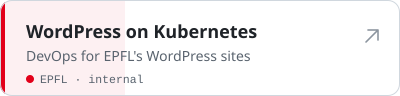</a>
<a href="https://duriaux.dev/projets/wp-veritas">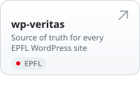</a>
<a href="https://xdew.cloud">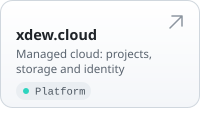</a>
<a href="https://xdew.studio">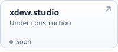</a>
<a href="https://kooked.ch">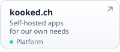</a>
<a href="https://github.com/dwesh163/capi-ui">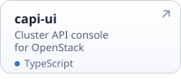</a>
<a href="https://github.com/dwesh163/create-stack">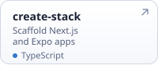</a>
<a href="https://github.com/dwesh163/shed">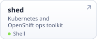</a>
<a href="https://github.com/dwesh163/BONDS">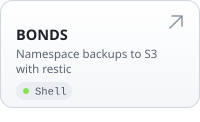</a>
<a href="https://github.com/dwesh163/outlinewiki-exporter">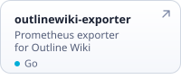</a>
<a href="https://github.com/dwesh163/skills">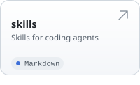</a>
<a href="https://github.com/dwesh163/actions">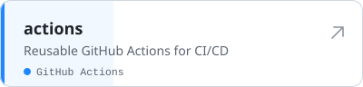</a>
<a href="https://github.com/dwesh163?tab=repositories">All repositories →</a>

## Stack

**Code** 

**Web** 

**Data** 

**Ops** 

**Tools** 

