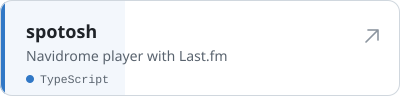

Apprentice IT specialist (CFC) at [EPFL](https://www.epfl.ch), based in Switzerland. I build web applications and run the infrastructure they live on. I have been coding since I was 9.

**[duriaux.dev](https://duriaux.dev)** · [Projects](https://duriaux.dev/projets) · [Background](https://duriaux.dev/parcours) · [Contact](https://duriaux.dev/contact)

## Projects

[All repositories →](https://github.com/dwesh163?tab=repositories)

## Stack

**Code** 

**Web** 

**Data** 

**Ops** 

**Tools** 

